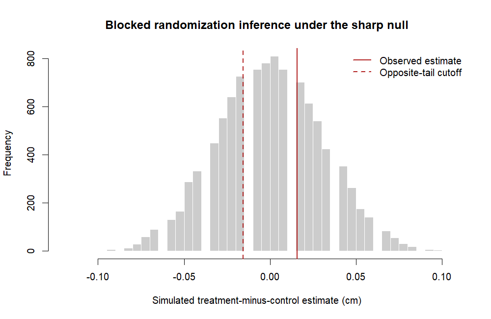
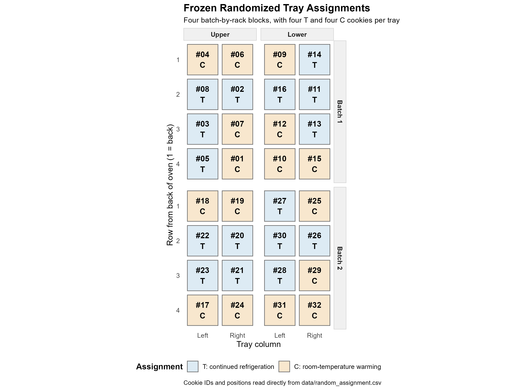

```{r setup, include=FALSE}
knitr::opts_chunk$set(echo = FALSE, warning = FALSE, message = FALSE)
# Knit this file from report/ in the GitHub repository.
required_files <- c(
  "../result/cookie_outcomes.png",
  "../result/treatment_effect_ci.png",
  "../result/randomization_inference.png",
  "../result/tray_randomization_layout.png",
  "../data/cookie_measurements.csv",
  "../data/random_assignment.csv",
  "../code/randomization.R",
  "../code/analysis.R",
  "../code/plot_treatment_effect.R",
  "../code/plot_tray_randomization.R"
)
missing_files <- required_files[!file.exists(required_files)]
if (length(missing_files) > 0L) {
  stop("Missing repository files: ", paste(missing_files, collapse = ", "),
       ". Save this Rmd inside the repository's report/ folder.")
}
```

\vspace{-2.1em}

*This experiment was preregistered at [AsPredicted #324567](https://aspredicted.org/8b3y59.pdf).*

# 1. Introduction

## 1.1 Motivation

Previous baking tests suggest that chilling homemade cookie dough reduces spreading. Hamel (2015) observed less spreading in chilled chocolate-chip dough, while Cho and Liang (2021) found that longer chilling resulted in smaller cookie diameters. However, it remains unclear whether these findings apply to commercially prepared, ready-to-bake dough, which is typically sold refrigerated. This experiment therefore examines whether keeping commercial cookie dough refrigerated until baking, rather than allowing it to warm at room temperature beforehand, affects the diameter of the baked cookies.

## 1.2 Hypothesis

**H1 (two-sided):** Mean baked cookie diameter differs between dough kept refrigerated until baking and dough allowed to warm at room temperature beforehand.

# 2. Experimental Design

The experiment used 32 pre-portioned pieces of Pillsbury Ready to Bake Sugar Cookie Dough from two packages. Each cookie served as both the unit of randomization and the unit of analysis. On November 14, 2026, the cookies were baked in two batches of 16, with eight cookies on each oven rack.

Random assignment was blocked by baking batch and oven rack to account for potential differences in baking conditions. Each of the four blocks contained four treatment and four control cookies, allowing comparisons within similar baking environments and potentially improving the precision of the estimated treatment effect. Positions within each tray were also randomized to reduce systematic differences in heat exposure (see Appendix A).

Treatment cookies (T) remained refrigerated for 180 minutes, while control cookies (C) were refrigerated for 90 minutes before being left at room temperature for another 90 minutes. Within each batch, both groups were baked simultaneously at 350°F for 17 minutes. After cooling on the baking trays for five minutes, two perpendicular diameters were measured across the bottom of each cookie to the nearest 0.1 cm. The average of these two measurements served as the preregistered outcome.

# 3. Core Assumptions

The design sought to satisfy three core assumptions. First, random assignment followed a predetermined within-block allocation, independent of the cookies' potential outcomes. Second, non-interference was supported by spacing cookies apart during baking, preventing them from merging and reducing the likelihood that one cookie's spreading would affect another's diameter. Third, excludability was supported by applying identical baking, cooling, and measurement procedures across treatment conditions, reducing the possibility that assignment would affect outcomes through pathways other than the intended temperature treatment.

# 4. Results

## 4.1 Descriptive Statistics

The mean baked cookie diameter was 5.8781 cm in the treatment group and 5.8625 cm in the control group, indicating a very small difference. As shown in Figure 1, the two groups' outcome distributions largely overlap, although the treatment group exhibited slightly greater variation (SD = 0.1064 cm) than the control group (SD = 0.0742 cm).

\begin{figure}[H]
\centering
\includegraphics[width=0.75\linewidth]{../result/cookie_outcomes.png}
\caption{Individual Cookie Diameters by Treatment Condition.}
\end{figure}

## 4.2 Statistical Inference

The preregistered estimand was the sample average treatment effect (ATE) of continued refrigeration relative to pre-baking warming. I estimated it using a blocked difference-in-means estimator, weighting each block's treatment-minus-control difference by its share of the total sample:

$$
\widehat{\mathrm{ATE}}_{\mathrm{blocked}}
=\sum_{b=1}^{4}\frac{N_b}{N}
\left(\bar{Y}_{Tb}-\bar{Y}_{Cb}\right).
$$

Because all four blocks had equal sizes and treatment proportions, the blocked estimate was identical to the pooled difference in means.

Table 1 reports an estimated ATE of +0.0156 cm (approximately 0.16 mm), indicating that refrigerated cookies were slightly wider on average. The conservative Neyman standard error was 0.0309 cm, reflecting the estimated variability of the blocked estimator across hypothetical random assignments. Since the standard error is nearly twice the magnitude of the estimated effect, the observed difference is small relative to its statistical uncertainty.

\Needspace{9\baselineskip}

The normal-approximation 95% confidence interval [−0.0449, 0.0762] cm includes zero, indicating that the data are compatible with either a small negative or positive treatment effect. Across hypothetical repeated random assignments, approximately 95% of confidence intervals constructed using this procedure would contain the true sample ATE. Since the interval includes zero, we cannot reject a zero average treatment effect at the 5% significance level.

\Needspace{13\baselineskip}

\begin{table}[H]
\centering
\caption{Main Experimental Results}
\begin{tabular}{@{}lr@{}}
\toprule
Statistic & Estimate \\
\midrule
Treatment mean (T; $n = 16$) & 5.8781 cm \\
Control mean (C; $n = 16$) & 5.8625 cm \\
Blocked ATE (T $-$ C) & +0.0156 cm \\
Conservative Neyman SE & 0.0309 cm \\
Normal-approximation 95\% CI & [$-0.0449$, 0.0762] cm \\
Two-sided Fisher RI $p$-value & 0.690 \\
Total observations & 32 \\
\bottomrule
\end{tabular}
\end{table}

A two-sided Fisher randomization test examined the sharp null hypothesis that treatment had no effect on any individual cookie:

$$
H_0^{\mathrm{sharp}}:\quad Y_i(1)=Y_i(0),\quad \forall i.
$$

Under this null hypothesis, I simulated 10,000 random reassignments, preserving four treatment and four control cookies within each block. The resulting p-value was 0.690, indicating that approximately 69.0% of simulated assignments produced absolute treatment-effect estimates at least as large as the observed estimate. Thus, the observed difference was not unusual under the sharp null, which we fail to reject at the 5% significance level. Figure 2 presents the estimated ATE and its confidence interval, while Appendix Figure A1 shows the randomization distribution.

\begin{figure}[H]
\centering
\includegraphics[width=0.95\linewidth]{../result/treatment_effect_ci.png}
\caption{Estimated Treatment Effect with 95\% Confidence Interval.}
\end{figure}

\Needspace{12\baselineskip}

# 5. Discussion and Conclusion

The estimated effect was slightly positive, in contrast to the reduced spreading associated with chilling in previous studies of homemade dough. However, the difference was too small and statistically uncertain to establish a contradictory finding. One possible explanation is that both groups began with refrigerated dough, which may have limited the contrast between treatment conditions, although this possibility was not directly tested.

The small sample size limits statistical precision, while the use of a single brand restricts generalizability. Future experiments could improve on this design by including larger samples and multiple brands, while retaining blocked randomization to examine whether treatment effects vary across products.

# References

Cho, K., & Liang, J. (2021). Examination of the effects of chilling time on the spreading of cookies. *The Expedition, 11*.  
<https://ojs.library.ubc.ca/index.php/expedition/article/view/196120>

Hamel, P. J. (2015). *Chilling cookie dough: Does it make a difference?* King Arthur Baking.  
<https://www.kingarthurbaking.com/blog/2015/05/17/chilling-cookie-dough>

\clearpage

# Appendix

## Appendix A. Experimental Assignment and Inference

**Appendix Figure A1. Randomization Distribution under the Sharp Null**

```{r appendix-ri, out.width="90%", fig.align='center'}

```

\clearpage

**Appendix Figure A2. Frozen Randomized Tray Assignments**

```{r appendix-layout, out.width="88%", fig.align='center'}

```

## Appendix B. Experimental Photographs

The photographs document the pre-baking setup and the upper and lower oven racks for each batch.

```{r appendix-photos, echo=FALSE, results='asis'}
photo_names <- c(
  "PreBaking_Setup_1.jpg", "PreBaking_Setup_2.jpg",
  "Batch1_Upper_Rack.jpg", "Batch1_Lower_Rack.jpg",
  "Batch2_Upper_Rack.jpg", "Batch2_Lower_Rack.jpg"
)
photo_labels <- c(
  "Pre-baking setup 1", "Pre-baking setup 2",
  "Batch 1: upper rack", "Batch 1: lower rack",
  "Batch 2: upper rack", "Batch 2: lower rack"
)
photo_paths <- file.path("../photos", photo_names)
if (any(!file.exists(photo_paths))) {
  stop("Missing original experimental photographs: ",
       paste(photo_paths[!file.exists(photo_paths)], collapse = ", "))
}
for (j in seq(1L, length(photo_names), by = 2L)) {
  cat("\\begin{center}\n")
  for (k in j:(j + 1L)) {
    cat("\\begin{minipage}[t]{0.47\\textwidth}\\centering\n")
    photo_height <- if (k <= 2L) "5cm" else "7cm"
    cat("\\includegraphics[width=\\linewidth,height=",
        photo_height, ",keepaspectratio]{", photo_paths[k], "}\n", sep = "")
    cat("\\par\\small\\textit{", photo_labels[k], "}\n", sep = "")
    cat("\\end{minipage}\n")
    if (k == j) cat("\\hfill\n")
  }
  cat("\\end{center}\n\\vspace{0.6em}\n")
}
```

\clearpage

## Appendix C. Complete Experimental Data

The following tables reproduce **all 32 records** in the archived CSV files. For readability, the original fields are displayed in three tables linked by cookie ID. The underlying files remain unchanged and machine-readable in the [GitHub repository](https://github.com/AbyssScott/POLS4724-Practicum-Experiment).

### Appendix C1. Frozen Random Assignment

Every cookie's batch, rack, position, row, column, and frozen treatment assignment is retained below. **T** denotes continued refrigeration; **C** denotes pre-baking warming.

\begingroup
\small
\renewcommand{\arraystretch}{0.98}

| Cookie ID | Batch | Rack | Position | Row | Column | T/C |
| :---: | :---: | :---: | :---: | :---: | :---: | :---: |
| 01 | 1 | Upper | 8 | 4 | Right | C |
| 02 | 1 | Upper | 4 | 2 | Right | T |
| 03 | 1 | Upper | 5 | 3 | Left | T |
| 04 | 1 | Upper | 1 | 1 | Left | C |
| 05 | 1 | Upper | 7 | 4 | Left | T |
| 06 | 1 | Upper | 2 | 1 | Right | C |
| 07 | 1 | Upper | 6 | 3 | Right | C |
| 08 | 1 | Upper | 3 | 2 | Left | T |
| 09 | 1 | Lower | 1 | 1 | Left | C |
| 10 | 1 | Lower | 7 | 4 | Left | C |
| 11 | 1 | Lower | 4 | 2 | Right | T |
| 12 | 1 | Lower | 5 | 3 | Left | C |
| 13 | 1 | Lower | 6 | 3 | Right | T |
| 14 | 1 | Lower | 2 | 1 | Right | T |
| 15 | 1 | Lower | 8 | 4 | Right | C |
| 16 | 1 | Lower | 3 | 2 | Left | T |
| 17 | 2 | Upper | 7 | 4 | Left | C |
| 18 | 2 | Upper | 1 | 1 | Left | C |
| 19 | 2 | Upper | 2 | 1 | Right | C |
| 20 | 2 | Upper | 4 | 2 | Right | T |
| 21 | 2 | Upper | 6 | 3 | Right | T |
| 22 | 2 | Upper | 3 | 2 | Left | T |
| 23 | 2 | Upper | 5 | 3 | Left | T |
| 24 | 2 | Upper | 8 | 4 | Right | C |
| 25 | 2 | Lower | 2 | 1 | Right | C |
| 26 | 2 | Lower | 4 | 2 | Right | T |
| 27 | 2 | Lower | 1 | 1 | Left | T |
| 28 | 2 | Lower | 5 | 3 | Left | T |
| 29 | 2 | Lower | 6 | 3 | Right | C |
| 30 | 2 | Lower | 3 | 2 | Left | T |
| 31 | 2 | Lower | 7 | 4 | Left | C |
| 32 | 2 | Lower | 8 | 4 | Right | C |

\endgroup

\clearpage

### Appendix C2. Individual Outcome Measurements

Both original bottom-face diameter measurements (cm) and their arithmetic mean are shown for every cookie; the latter is the preregistered outcome.

\begingroup
\small
\renewcommand{\arraystretch}{0.98}

| Cookie ID | T/C | Width 1 (cm) | Width 2 (cm) | Mean (cm) |
| :---: | :---: | :---: | :---: | :---: |
| 01 | C | 5.7 | 6.1 | 5.90 |
| 02 | T | 5.5 | 6.1 | 5.80 |
| 03 | T | 5.8 | 6.1 | 5.95 |
| 04 | C | 5.7 | 6.2 | 5.95 |
| 05 | T | 5.5 | 6.0 | 5.75 |
| 06 | C | 5.5 | 6.0 | 5.75 |
| 07 | C | 5.8 | 6.2 | 6.00 |
| 08 | T | 6.0 | 6.0 | 6.00 |
| 09 | C | 5.6 | 6.1 | 5.85 |
| 10 | C | 5.7 | 6.1 | 5.90 |
| 11 | T | 6.0 | 6.1 | 6.05 |
| 12 | C | 5.8 | 6.2 | 6.00 |
| 13 | T | 6.1 | 5.9 | 6.00 |
| 14 | T | 5.9 | 5.7 | 5.80 |
| 15 | C | 5.9 | 5.9 | 5.90 |
| 16 | T | 5.4 | 6.2 | 5.80 |
| 17 | C | 5.6 | 6.0 | 5.80 |
| 18 | C | 5.9 | 5.7 | 5.80 |
| 19 | C | 5.8 | 5.8 | 5.80 |
| 20 | T | 5.7 | 5.9 | 5.80 |
| 21 | T | 5.7 | 6.1 | 5.90 |
| 22 | T | 6.1 | 6.0 | 6.05 |
| 23 | T | 5.9 | 6.0 | 5.95 |
| 24 | C | 5.7 | 6.0 | 5.85 |
| 25 | C | 5.9 | 5.8 | 5.85 |
| 26 | T | 5.8 | 5.8 | 5.80 |
| 27 | T | 5.8 | 5.9 | 5.85 |
| 28 | T | 5.6 | 5.9 | 5.75 |
| 29 | C | 5.6 | 6.1 | 5.85 |
| 30 | T | 5.5 | 6.1 | 5.80 |
| 31 | C | 5.6 | 6.0 | 5.80 |
| 32 | C | 5.8 | 5.8 | 5.80 |

\endgroup

\clearpage

### Appendix C3. Timing and Deviation Records

All times below refer to **November 14, 2026** (HH:MM, local time). “Room start” is blank for treatment cookies because they were never warmed at room temperature. An em dash in the notes column represents the original blank field; all observations were valid.

| Cookie ID | Oven entry | Room start | Bake (min) | Cool (min) | Notes |
| :---: | :---: | :---: | :---: | :---: | :---: |
| 01 | 13:55 | 12:25 | 17 | 5 | — |
| 02 | 13:55 | — | 17 | 5 | — |
| 03 | 13:55 | — | 17 | 5 | — |
| 04 | 13:55 | 12:25 | 17 | 5 | — |
| 05 | 13:55 | — | 17 | 5 | — |
| 06 | 13:55 | 12:25 | 17 | 5 | — |
| 07 | 13:55 | 12:25 | 17 | 5 | — |
| 08 | 13:55 | — | 17 | 5 | — |
| 09 | 13:55 | 12:25 | 17 | 5 | — |
| 10 | 13:55 | 12:25 | 17 | 5 | — |
| 11 | 13:55 | — | 17 | 5 | — |
| 12 | 13:55 | 12:25 | 17 | 5 | — |
| 13 | 13:55 | — | 17 | 5 | — |
| 14 | 13:55 | — | 17 | 5 | — |
| 15 | 13:55 | 12:25 | 17 | 5 | — |
| 16 | 13:55 | — | 17 | 5 | — |
| 17 | 18:10 | 16:40 | 17 | 5 | — |
| 18 | 18:10 | 16:40 | 17 | 5 | — |
| 19 | 18:10 | 16:40 | 17 | 5 | — |
| 20 | 18:10 | — | 17 | 5 | — |
| 21 | 18:10 | — | 17 | 5 | — |
| 22 | 18:10 | — | 17 | 5 | — |
| 23 | 18:10 | — | 17 | 5 | — |
| 24 | 18:10 | 16:40 | 17 | 5 | — |
| 25 | 18:10 | 16:40 | 17 | 5 | — |
| 26 | 18:10 | — | 17 | 5 | — |
| 27 | 18:10 | — | 17 | 5 | — |
| 28 | 18:10 | — | 17 | 5 | — |
| 29 | 18:10 | 16:40 | 17 | 5 | — |
| 30 | 18:10 | — | 17 | 5 | — |
| 31 | 18:10 | 16:40 | 17 | 5 | — |
| 32 | 18:10 | 16:40 | 17 | 5 | — |

\clearpage

## Appendix D. Complete R Programs

The following blocks reproduce the complete source programs for frozen randomization verification, the preregistered analysis, and both additional figures. These are **source-code listings for reproducibility**, not analyses rerun during knitting. They retain the original code, indentation, and comments.

### Appendix D1. Randomization Verification (`code/randomization.R`)

```r
# Fixed, auditable random assignment: 4 batch-by-rack blocks, 4T/4C each.
# A deterministic Lehmer PRNG is used so the archived CSV can be exactly
# reproduced in either R or Python. Do not re-run to choose a nicer layout.
state <- 472416
next_index <- function(n) {
  state <<- (state * 16807) %% 2147483647
  as.integer(state %% n) + 1L
}
shuffle_fixed <- function(x) {
  if (length(x) > 1L) {
    for (i in seq.int(length(x), 2L, by = -1L)) {
      j <- next_index(i)
      temp <- x[i]
      x[i] <- x[j]
      x[j] <- temp
    }
  }
  x
}

block_list <- list()
k <- 0L
for (batch in 1:2) {
  for (rack in c("Upper", "Lower")) {
    ids <- seq.int(k + 1L, k + 8L)
    z <- shuffle_fixed(c(rep("T", 4L), rep("C", 4L)))
    pos <- shuffle_fixed(1:8)
    block_list[[length(block_list) + 1L]] <- data.frame(
      cookie_id = sprintf("%02d", ids),
      batch = batch,
      rack = rack,
      position = pos,
      row_from_back = (pos + 1L) %/% 2L,
      column = ifelse(pos %% 2L == 1L, "Left", "Right"),
      assignment = z,
      stringsAsFactors = FALSE
    )
    k <- k + 8L
  }
}
assignment <- do.call(rbind, block_list)
stopifnot(nrow(assignment) == 32L)
stopifnot(all(table(assignment$batch, assignment$rack,
                    assignment$assignment) == 4L))
stopifnot(all(vapply(split(assignment, interaction(assignment$batch,
                     assignment$rack)), function(b) {
  identical(sort(b$position), 1:8)
}, logical(1))))

# From the repository root, run: Rscript code/randomization.R
# The original assignment file is frozen and must NOT be overwritten.
data_file <- if (file.exists("../data/random_assignment.csv")) {
  "../data/random_assignment.csv"
} else {
  "data/random_assignment.csv"
}
archive <- read.csv(data_file, colClasses = c(cookie_id = "character"),
                    stringsAsFactors = FALSE)
for (nm in names(assignment)) {
  stopifnot(identical(as.character(assignment[[nm]]),
                      as.character(archive[[nm]])))
}
cat("Verified: frozen random assignment matches seed 472416.\n")
print(assignment[order(assignment$batch, assignment$rack,
                       assignment$position), ])
```

### Appendix D2. Blocked Estimation and Fisher RI (`code/analysis.R`)

```r
# This file must be run AFTER all 32 cookie widths have been recorded.
# From repository root: Rscript code/analysis.R
# Primary outcome: mean of two perpendicular bottom-face widths in cm.
data_file <- if (file.exists("../data/cookie_measurements.csv")) {
  "../data/cookie_measurements.csv"
} else {
  "data/cookie_measurements.csv"
}
dat <- read.csv(data_file, colClasses = c(cookie_id = "character"),
                stringsAsFactors = FALSE)
stopifnot(nrow(dat) == 32L, all(dat$assignment %in% c("T", "C")))
stopifnot(all(table(dat$batch, dat$rack, dat$assignment) == 4L))
dat$Y <- (as.numeric(dat$width1_cm) + as.numeric(dat$width2_cm)) / 2
if (anyNA(dat$Y)) {
  stop("Some outcomes are missing. Document deviations before analysis; ",
       "the preregistered complete-data estimator cannot be applied unchanged.")
}
dat$block <- interaction(dat$batch, dat$rack, drop = TRUE)
blocks <- split(dat, dat$block)
within_block <- function(d) {
  yt <- d$Y[d$assignment == "T"]
  yc <- d$Y[d$assignment == "C"]
  c(n = nrow(d), tau = mean(yt) - mean(yc),
    variance = var(yt) / length(yt) + var(yc) / length(yc))
}
block_stats <- t(vapply(blocks, within_block, numeric(3)))
w <- block_stats[, "n"] / sum(block_stats[, "n"])
tau_hat <- sum(w * block_stats[, "tau"])
se_hat <- sqrt(sum(w^2 * block_stats[, "variance"]))
ci95 <- tau_hat + c(-1, 1) * qnorm(0.975) * se_hat
cat(sprintf("ATE (continued refrigeration minus warming): %.4f cm\n",
            tau_hat))
cat(sprintf("Neyman blocked SE: %.4f cm\n", se_hat))
cat(sprintf("Normal-approx. 95%% CI: [%.4f, %.4f] cm\n",
            ci95[1], ci95[2]))
cat("Treatment and control mean widths (cm):\n")
print(tapply(dat$Y, dat$assignment, mean))

# Two-sided sharp-null randomization inference, respecting each block.
set.seed(472417)
B <- 10000L
indices <- split(seq_len(nrow(dat)), dat$block)
ri_estimates <- replicate(B, {
  perm_z <- dat$assignment
  for (idx in indices) {
    perm_z[idx] <- sample(c(rep("T", 4L), rep("C", 4L)))
  }
  sum(vapply(seq_along(indices), function(i) {
    idx <- indices[[i]]
    w[i] * (mean(dat$Y[idx][perm_z[idx] == "T"]) -
            mean(dat$Y[idx][perm_z[idx] == "C"]))
  }, numeric(1)))
})
# Include boundary ties despite floating-point rounding.
tol <- 1e-10
ri_p <- (1 + sum(abs(ri_estimates) >= abs(tau_hat) - tol)) / (B + 1)
cat(sprintf("Two-sided blocked sharp-null RI p-value: %.5f\n", ri_p))

# Save two figures for the practicum report; no extra statistical tests.
# Paths work when launched from either the repository root or code/.
plot_dir <- if (file.exists("../data/cookie_measurements.csv")) {
  "../result"
} else {
  "result"
}
dir.create(plot_dir, showWarnings = FALSE, recursive = TRUE)

# Figure 1: Fisher sharp-null randomization distribution.
png(file.path(plot_dir, "randomization_inference.png"),
    width = 1000, height = 650, res = 120)
hist(ri_estimates, breaks = 35, col = "grey80", border = "white",
     main = "Blocked randomization inference under the sharp null",
     xlab = "Simulated treatment-minus-control estimate (cm)")
abline(v = tau_hat, lwd = 2, col = "firebrick")
abline(v = -tau_hat, lwd = 2, col = "firebrick", lty = 2)
legend("topright", legend = c("Observed estimate", "Opposite-tail cutoff"),
       col = "firebrick", lty = c(1, 2), lwd = 2, bty = "n")
dev.off()

# Figure 2: Coppock-style individual outcomes and group means.
# The displayed 95% intervals describe each group mean; the formal
# preregistered inference for the blocked ATE is reported above.
groups <- c("C", "T")
values <- lapply(groups, function(z) dat$Y[dat$assignment == z])
group_means <- vapply(values, mean, numeric(1))
group_ses <- vapply(values, function(x) sd(x) / sqrt(length(x)), numeric(1))
lo <- group_means - qnorm(0.975) * group_ses
hi <- group_means + qnorm(0.975) * group_ses
ylim <- range(c(unlist(values), lo, hi))
pad <- max(0.05, diff(ylim) * 0.12)
png(file.path(plot_dir, "cookie_outcomes.png"),
    width = 900, height = 650, res = 120)
plot(1:2, group_means, type = "n", xlim = c(0.5, 2.5),
     ylim = ylim + c(-pad, pad), xaxt = "n", xlab = "",
     ylab = "Baked cookie diameter (cm)",
     main = "Individual cookie diameters and group means")
axis(1, at = 1:2, labels = c("Control: warming", "Treatment: chilled"))
set.seed(472418)  # Jitter only; does not affect any estimates.
for (j in 1:2) {
  points(j + runif(length(values[[j]]), -0.13, 0.13), values[[j]],
         pch = 16, col = grDevices::adjustcolor("grey30", alpha.f = 0.45))
}
segments(1:2, lo, 1:2, hi, lwd = 2)
segments((1:2) - 0.06, lo, (1:2) + 0.06, lo, lwd = 2)
segments((1:2) - 0.06, hi, (1:2) + 0.06, hi, lwd = 2)
points(1:2, group_means, pch = 18, cex = 1.8)
mtext("Diamonds: group means; bars: approximate 95% CIs for group means",
      side = 1, line = 3, cex = 0.75)
dev.off()
cat("Saved figures in: ", plot_dir, "\n", sep = "")
```

### Appendix D3. Treatment-Effect CI Figure (`code/plot_treatment_effect.R`)

```r
# Figure 2. Estimated blocked ATE and normal-approximation 95% CI.
# From the repository root: source("code/plot_treatment_effect.R")
# Supplementary visualization only; original analysis.R remains unchanged.

input_path <- if (file.exists("data/cookie_measurements.csv")) {
  "data/cookie_measurements.csv"
} else {
  "../data/cookie_measurements.csv"
}
output_dir <- if (file.exists("data/cookie_measurements.csv")) "result" else "../result"

dat <- read.csv(input_path, colClasses = c(cookie_id = "character"),
                stringsAsFactors = FALSE)
stopifnot(nrow(dat) == 32L)
stopifnot(all(table(dat$batch, dat$rack, dat$assignment) == 4L))
dat$Y <- (dat$width1_cm + dat$width2_cm) / 2
stopifnot(!anyNA(dat$Y))
dat$block <- interaction(dat$batch, dat$rack, drop = TRUE)
blocks <- split(dat, dat$block)

calc_block <- function(x) {
  yt <- x$Y[x$assignment == "T"]
  yc <- x$Y[x$assignment == "C"]
  c(n = nrow(x), ate = mean(yt) - mean(yc),
    var_hat = var(yt) / length(yt) + var(yc) / length(yc))
}
block_results <- t(vapply(blocks, calc_block, numeric(3)))
weights <- block_results[, "n"] / sum(block_results[, "n"])
ate <- sum(weights * block_results[, "ate"])
se <- sqrt(sum(weights^2 * block_results[, "var_hat"]))
ci <- ate + qnorm(c(0.025, 0.975)) * se

# Checks against the preregistered analyses reported in the main report.
stopifnot(isTRUE(all.equal(ate, 0.015625, tolerance = 1e-10)))
stopifnot(isTRUE(all.equal(se, 0.03088326475077826,
                           tolerance = 1e-10)))

dir.create(output_dir, recursive = TRUE, showWarnings = FALSE)
file_out <- file.path(output_dir, "treatment_effect_ci.png")
png(file_out, width = 1800, height = 700, res = 220)
par(mar = c(5, 3.2, 4.8, 1.5), family = "sans")
plot(NA, xlim = c(-0.072, 0.101), ylim = c(0.55, 1.55), yaxt = "n",
     ylab = "", xlab = "Treatment effect on baked cookie diameter (cm)",
     bty = "n", main = "Estimated effect of continued refrigeration")
abline(v = 0, lty = 2, lwd = 1.4, col = "gray45")
segments(ci[1], 1, ci[2], 1, lwd = 2.3, col = "steelblue4")
segments(ci, 0.945, ci, 1.055, lwd = 2.3, col = "steelblue4")
points(ate, 1, pch = 18, cex = 2, col = "steelblue4")
text(ate, 1.18, sprintf("ATE = %+.4f cm", ate), cex = 0.92)
text(ci[1], 0.82, sprintf("%.4f", ci[1]), cex = 0.78)
text(ci[2], 0.82, sprintf("%.4f", ci[2]), cex = 0.78)
mtext("Treatment (chilled) minus control (warmed); N = 32, four blocks",
      side = 3, line = 0.7, cex = 0.87)
mtext("Bar: normal-approximation 95% CI; dashed line: zero effect",
      side = 1, line = 3.7, cex = 0.75)
dev.off()
cat(sprintf("Figure saved to: %s\nATE = %.6f cm; SE = %.6f cm; CI = [%.6f, %.6f] cm\n",
            file_out, ate, se, ci[1], ci[2]))
```

### Appendix D4. Frozen Tray Layout Figure (`code/plot_tray_randomization.R`)

```r
# POLS GU4724 Practicum: frozen tray-assignment visualization
# Run from the repository root:
#   Rscript code/plot_tray_randomization.R
# Or open this script in RStudio and run it from the root or code/ folder.
#
# Visualization only: this script reads the frozen random_assignment.csv.
# It does NOT draw a new random assignment or change the preregistration.
# Requires ggplot2 (install once with install.packages("ggplot2")).

if (!requireNamespace("ggplot2", quietly = TRUE)) {
  stop("Package 'ggplot2' is required: install.packages('ggplot2')")
}

# Locate the repository's frozen allocation file.
if (file.exists("data/random_assignment.csv")) {
  root <- "."
} else if (file.exists("../data/random_assignment.csv")) {
  root <- ".."
} else {
  stop("Cannot find data/random_assignment.csv. Run from the repo root ",
       "or the code/ directory.")
}

input_path <- file.path(root, "data", "random_assignment.csv")
dat <- read.csv(input_path,
                colClasses = c(cookie_id = "character"),
                stringsAsFactors = FALSE)

# Validate the original 32-unit, four-block, balanced design.
required <- c("cookie_id", "batch", "rack", "position",
              "row_from_back", "column", "assignment")
stopifnot(all(required %in% names(dat)),
          nrow(dat) == 32L,
          !anyNA(dat[required]),
          !anyDuplicated(dat$cookie_id),
          setequal(dat$batch, c(1, 2)),
          setequal(dat$rack, c("Upper", "Lower")),
          setequal(dat$assignment, c("T", "C")),
          setequal(dat$column, c("Left", "Right")),
          setequal(dat$row_from_back, 1:4),
          setequal(dat$position, 1:8),
          all(table(dat$batch, dat$rack, dat$assignment) == 4L),
          all(table(dat$batch, dat$rack, dat$position) == 1L))

# Position 1 is back-left; 2 is back-right; 7 is front-left;
# 8 is front-right. This reproduces the frozen tray-coordinate scheme.
column_number <- match(dat$column, c("Left", "Right"))
stopifnot(all(dat$position == 2L * (dat$row_from_back - 1L) +
              column_number))

dat$x <- column_number
dat$panel_batch <- factor(dat$batch, levels = c(1, 2),
                          labels = c("Batch 1", "Batch 2"))
dat$panel_rack <- factor(dat$rack, levels = c("Upper", "Lower"))
dat$label <- paste0("#", dat$cookie_id, "\n", dat$assignment)

# A 2-by-2 panel figure, with each rack showing 2 columns x 4 rows.
# Row 1 is shown at the TOP because it is closest to the back of the oven.
p <- ggplot2::ggplot(
  dat, ggplot2::aes(x = x, y = row_from_back)
) +
  ggplot2::geom_tile(
    ggplot2::aes(fill = assignment),
    width = 0.88, height = 0.88, colour = "grey45", linewidth = 0.45
  ) +
  ggplot2::geom_text(
    ggplot2::aes(label = label),
    size = 4.2, lineheight = 1.1, fontface = "bold"
  ) +
  ggplot2::scale_fill_manual(
    values = c("T" = "#DDEBF4", "C" = "#F8E7CE"),
    breaks = c("T", "C"),
    labels = c("T: continued refrigeration", "C: room-temperature warming")
  ) +
  ggplot2::scale_x_continuous(
    breaks = 1:2, labels = c("Left", "Right"),
    limits = c(0.45, 2.55), expand = c(0, 0)
  ) +
  ggplot2::scale_y_reverse(
    breaks = 1:4, limits = c(4.55, 0.45), expand = c(0, 0)
  ) +
  ggplot2::facet_grid(panel_batch ~ panel_rack) +
  ggplot2::coord_fixed(ratio = 1) +
  ggplot2::labs(
    title = "Frozen Randomized Tray Assignments",
    subtitle = "Four batch-by-rack blocks, with four T and four C cookies per tray",
    x = "Tray column",
    y = "Row from back of oven (1 = back)",
    fill = "Assignment",
    caption = "Cookie IDs and positions read directly from data/random_assignment.csv"
  ) +
  ggplot2::theme_minimal(base_size = 12) +
  ggplot2::theme(
    panel.grid = ggplot2::element_blank(),
    strip.background = ggplot2::element_rect(
      fill = "grey94", colour = "grey75", linewidth = 0.4
    ),
    strip.text = ggplot2::element_text(face = "bold"),
    axis.text = ggplot2::element_text(colour = "grey25"),
    legend.position = "bottom",
    legend.title = ggplot2::element_text(face = "bold"),
    plot.title = ggplot2::element_text(face = "bold", size = 15),
    plot.subtitle = ggplot2::element_text(size = 11),
    plot.caption = ggplot2::element_text(size = 9, hjust = 0)
  )

# Save the R-generated figure using the report's expected filename.
output_path <- file.path(root, "result", "tray_randomization_layout.png")
dir.create(dirname(output_path), recursive = TRUE, showWarnings = FALSE)
ggplot2::ggsave(output_path, plot = p, width = 10.5, height = 8,
                units = "in", dpi = 300, bg = "white")
message("Saved reproducible tray diagram to: ", output_path)
```

### Reproduction Instructions

From the repository root, run the following commands in R:

```r
source("code/randomization.R")
source("code/analysis.R")
source("code/plot_treatment_effect.R")
source("code/plot_tray_randomization.R")
```

The randomization script **verifies the archived assignment**; it does not overwrite `data/random_assignment.csv`. The R scripts should be run from the repository root as explained in the README.
